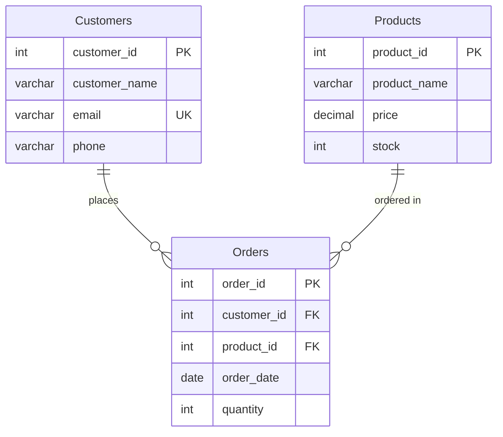

# Online Store Database

A relational database for a small online store, built with MySQL. It stores customers, products and orders, and includes a set of SQL queries for reporting on that data.

> **Team project:** this was submitted as a group project. My role was writing the project's documentation report.

## Database structure

The database (`OnlineStoreDB`) has three tables:

| Table | Columns | Constraints |
|---|---|---|
| **Customers** | `customer_id`, `customer_name`, `email`, `phone` | Primary key, `email` is `UNIQUE` and `NOT NULL` |
| **Products** | `product_id`, `product_name`, `price`, `stock` | Primary key, `CHECK (price > 0)`, `CHECK (stock >= 0)` |
| **Orders** | `order_id`, `customer_id`, `product_id`, `order_date`, `quantity` | Primary key, two foreign keys with `ON DELETE CASCADE`, `CHECK (quantity > 0)` |

### Relationships

- One customer can place many orders (`Orders.customer_id` → `Customers.customer_id`).
- One product can appear in many orders (`Orders.product_id` → `Products.product_id`).
- Deleting a customer or a product also deletes their orders (`ON DELETE CASCADE`).



Each table is filled with 5 sample records.

## Queries included

| # | Type | What it does |
|---|---|---|
| 1 | Filtering (`WHERE`) | Products with a price above 500 |
| 2 | Filtering (`WHERE`) | Customer details for a given email |
| 3 | `COUNT` | Total number of products |
| 4 | `SUM` + `GROUP BY` | Total quantity ordered for each product |
| 5 | `INNER JOIN` | Customer name with order date and quantity |
| 6 | Subquery with `IN` | Products that have been ordered at least once |
| 7 | `VIEW` | `Order_Summary_Report`: joins all three tables to show order ID, customer name, product name, quantity and date |

## How to run

**Option 1: MySQL Workbench**
Open `OnlineStoreDB.sql` and run the whole script.

**Option 2: command line**

```bash
mysql -u root -p < OnlineStoreDB.sql
```

The script drops and recreates `OnlineStoreDB`, so it can be run more than once.

> MySQL 8.0.16 or newer is needed for the `CHECK` constraints to be enforced.

## Technologies

- MySQL
- MySQL Workbench
